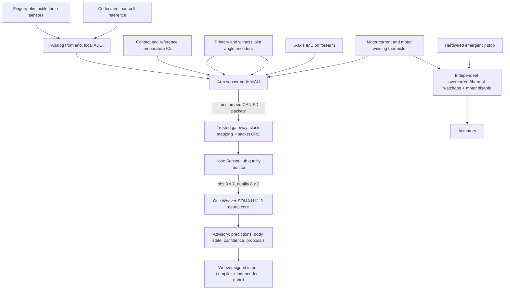

# SOMA-SENSE V1: Physical sensor design for Weaver-SOMA

**Status: hardware reference design + locally tested CPU fault monitor. No physical circuit is fabricated or validated.** The code fits the existing Weaver-SOMA U1/U2 **numeric sensor interface**; it does not make a robot safe or prove consciousness.

## What SOMA needs to know

The system should distinguish (a) **what contacted the body, where and when**, (b) **body position, force and skin/actuator temperature**, (c) **what motion SOMA commanded versus what actually moved**, and (d) **how trustworthy each observation is**. Later stages can learn an explicit articulated body graph and counterfactual self-versus-external agency. The first version is a practical one-arm/finger experimental rig.

## Modular topology

**Separate physically safety-rated motor shutdown from the AI service and its network**. This document does not specify a certified controller, safety integrity rating, torque limit or human-contact permit. These need the actual actuator, mass, gearbox, operating envelope and hazard analysis.

## First build: one instrumented finger/forearm bench module

| Measured quantity | Suggested first component / class | Placement | Proposed useful rate | Interface and engineering caution |
|---|---|---|---|---|
| Touch / force distribution | 4 to 8 flex sensors or force-sensitive resistor taxels, e.g. Tekscan A201 | fingertip, finger pad, palm | 100-200 Hz | Analog op-amp, external ADC. Calibrate force in N at each taxel. Force and pressure are **not** interchangeable. |
| Force reference | Independent calibrated small load cell + suitable ADC | mechanically shared force path at finger tip | 100-200 Hz | Co-located witness for force; do not compare force paths that experience different loads. |
| Contact thermal state | TI TMP117 plus co-located independent thermal witness | contact patch (small protective enclosure) | 5-10 Hz | Local I2C, no I2C across long moving cable. Thermal mounting and self-heating matter. |
| Joint angle | ams OSRAM AS5048A primary and optional independent witness (or mechanically independent pot) | each tested joint | 200-500 Hz | 14-bit rotary encoder SPI; requires magnet alignment and zero/stop calibration. Encoder resolution is not angular accuracy. |
| Link motion | TDK ICM-42688-P 6-axis IMU | forearm/wrist rigid link | 100-200 Hz | SPI/local node. Gyro measures angular velocity; reference to joint motion requires known kinematics and alignment. |
| Motor effort | TI INA226 current/power monitor and separately rated motor temperature sensor | power feed, winding or gearbox | 50-200 Hz current, 5-20 Hz thermal | Use independent current comparator, thermal fuse/protection, and actuator stop circuit as applicable. |
| Mechanical limit | Normally-closed limit switch + independently checked stop | joint boundaries | interrupt/event | Always acts through a separate deterministic interlock, not learned ML. |

### Technical source validation

- TI TMP117 digital temperature sensor, ±0.1°C max (-20 to 50°C), I2C with four addresses; a good **local** thermal reference IC: https://www.ti.com/product/TMP117
- ams OSRAM AS5048A 14-bit magnetic 360° rotary sensor with SPI, nominal 0.0219° per code: https://look.ams-osram.com/m/287d7ad97d1ca22e/original/AS5048-DS000298.pdf
- TDK ICM-42688-P 6-axis gyroscope/accelerometer with SPI/I2C/I3C, marketed for robotics: https://www.invensense.tdk.com/en-us/products/6-axis/icm-42688-p
- Tekscan FlexiForce A201, ranges 4.4/111/445 N, characterized hysteresis and drift; treat readings as approximate force until calibrated: https://www.tekscan.com/products-solutions/force-sensors/flexiforce-a201-sensor
- TI INA226 shunt current/power monitor supports bus sensing up to 36V; suitable only if the *actual* motor power architecture is within its limits: https://www.ti.com/product/INA226

**Do not assume datasheet accuracy after assembly**. Packaging, humidity, adhesive, cable bending, mounting pressure, mechanical stack-up, and calibration error may dominate. Verify datasheet revisions when ordering.

## Sensor node and bus

An MCU with sufficient ADC channels, SPI, I2C, watchdog and CAN-FD is a strong option. Suggested first node: one MCU servicing a finger/hand array, separate sensor rail, local regulators, strain relief and an isolated or correctly designed CAN transceiver if required. Avoid exposing unprotected 3.3V analog lines over long actuator cables. The MCU should stamp sample time on acquisition, assign monotonically increasing per-channel sequence numbers, include calibration identity, and publish raw and already calibrated data separately.

For one-arm CAN-FD network, target **50-200 Hz** packed telemetry depending on payload and priority. The 120 ms SOMA legacy window has eight historical timesteps and can be built by time-aligned resampling. MCU-side diagnostics must check supply, ADC saturation, sensor disconnected, and bus faults. A host-side Python model should *not* claim a timestamp is trustworthy merely because a device put it in a field: authenticate node identity, map node clocks to host monotonic time and validate drift/jitter using a trusted gateway. CRC catches accidental corruption but is not authentication.

## Mapping to the actual existing model

The U1/U2 model currently accepts:

- `obs: float32[batch,8,7]` as `[pressure_kPa, temperature_C, joint_fraction, dP/dt, dT/dt, dJoint/dt, contact_bit]`
- `quality: float32[batch,8,3]` as valid masks for `[pressure, temperature, joint]`
- `context: float32[batch,8]`; `executed_action: float32[batch,3]`

The `sensor_hub.py` adapter performs **forward-only zero-order hold** to 120 ms grid, and masks values *and derivatives* when an input or the preceding step was invalid or suspect. For each channel, the output quality is binary `q=1` only when both time samples are validated. It deliberately never interpolates through unseen future measurements. Since U1 doesn't mask its contact flag internally, the adapter forces that bit to zero whenever pressure is invalid. It never forwards NaN, infinities or uncalibrated engineering units.

**Important model mismatch:** the old simulator used `pressure_kPa`. A FlexiForce sensor outputs force-dependent conductance and must first be calibrated into **force newtons**. To calculate `kPa = force_N / (contact_area_m² * 1000)`, the *actual contact area must be measured or estimated responsibly*. For irregular touch patches, use a learned taxel encoder on calibrated forces instead of pretending each taxel measures absolute pressure. The current numeric model's “contact” threshold (8 kPa) is simulator-specific, **not** a real robot contact or safety threshold.

A future SOMA-3 should use a **per-part sensor graph** and learned taxel embeddings rather than compress a humanoid's full body to three scalar readings. The present adapter is intentionally minimal to preserve U1 weight compatibility.

## Fault detection hierarchy

1. **Packet / transport:** CRC, capture-to-receipt age, sequence replay, monotonic timestamps, channel/schema identity, unit, calibration ID; reject and latch suspicious channels until a fresh valid sample.
2. **Single-channel local:** independently verified ADC rail, supply, saturation, missed samples, stale sensor, out of configured operating range; check rates as **suspicions**, not proofs (fast impacts can be real).
3. **Independent comparison:** co-located paired force/thermal/angle witness; disagreement means **at least one** is unreliable, not that the primary is necessarily wrong.
4. **Cross-modal consistency:** commanded motion vs encoder rotation vs rigid-link inertial motion vs electrical current, with latency/geometry accounted for. This is a next-stage algorithm; merely having a motor command doesn't prove the joint moved.
5. **Multi-sample uncertainty:** clean/changed/novel regimes, dropout rate, reference missingness, bounded confidence intervals and out-of-distribution tests. A model-generated confidence number is not a fault flag.

A single sensor can be frozen at a plausible value and evade detection if its independent reference doesn't change far enough. A common supply fault can affect both witnesses together. This limitation survives any binary health mask; genuinely independent physical channels, excitation, and fail-safe limits are needed.

## Calibration checklist (before powered movement)

- Calibrate each force sensor with known loads across increasing/decreasing sweeps; check creep, hysteresis and thermal drift. Record units and measurement uncertainty, not just a scalar gain.
- Map each joint encoder's 0..1 normalized position to measured mechanical endpoints, inspect magnet alignment and quantify backlash. Validate against independent physical stops.
- Compare each thermal channel against a traceable reference at several points after enclosure assembly; check skin contact and thermal lag.
- Confirm sample time synchronization with oscilloscope or traceable timing reference, measure worst-case latencies, loss, stale behavior, and corrupted bus frames.
- Inject single and common-mode failures, disconnected sensors, power brownouts, stuck values and rejected calibration versions without motors enabled.
- **Only after independent engineering review:** validate a physical motor-disable chain, mechanical guards, software-in-the-loop and gradual hardware-in-the-loop. The AI must not directly authorize motion.

## Development gates

**V1 achieved:** data contract, sample verification, peer mismatch, stale/replay and metadata rejection, U1 checkpoint interoperability on CPU, and synthetic fault injection with known blind spots. **Not achieved:** real-world calibration, tested CAN gateway, contact taxel geometry, synchronized IMUs, physically independent self-motion detection, dynamic mechanical safety, compliance or consciousness evaluation.