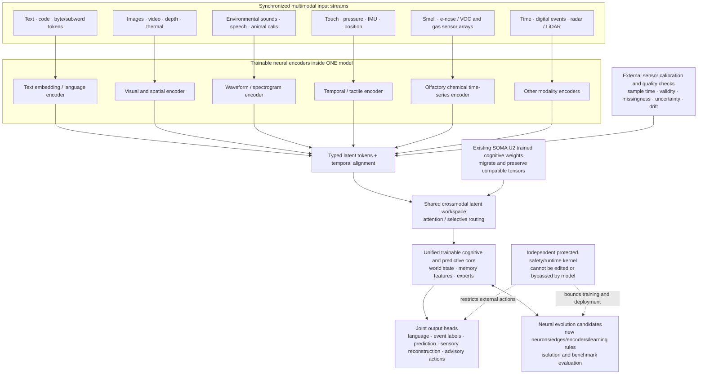

# SOMA U3 unified multimodal neural architecture

**Status:** Design specification, not yet implemented or trained. The protected starting point is Weaver-SOMA U2, a 100,206,197-parameter PyTorch model with research-only synthetic sensor/physics training documented in its own branch. No existing neural weights are replaced by this document.

## One native jointly trainable model

SOMA U3 is intended to be a single `torch.nn.Module`, with modality-specific trainable submodules and a common latent workspace. Not an agent orchestrating external model APIs. Separate trainable encoders do not imply separate independent AI agents. Model input can include zero, one or several modalities with explicit availability masks.

## Architecture diagram

## Olfactory input specification

**Input source:** An actual calibrated electronic-nose sensor array. Generic gas/VOC sensors produce measurements, not human-equivalent smell labels. Sensor selectivity, humidity, temperature, contamination, cross-sensitivity, sensor aging and device drift all matter.

**Model-side fields for each reading:**
- `samples[t, channels]`: numeric chemical sensor response time series, optionally normalized using sensor-specific calibration.
- `timestamps[t]`: monotonic or externally synchronized observation times, with sampling information.
- `sensor_id` and `calibration_version`: instrument provenance.
- `environment[t]`: temperature, relative humidity and other relevant covariates.
- `quality[t, channels]`: invalid/missing/saturated flags and drift/uncertainty indicators.

**Encoder:** A learnable 1D convolutional and/or recurrent/attention-based olfactory time-series network, with sensor identity embeddings, mask-aware normalization, and a projection from chemical features to the shared `d_model` latent tokens. Its parameters are part of SOMA U3's weights and jointly learnable alongside the common backbone.

**Training and tests:** begin with measured gas-array datasets and independent train/dev/test splits separated by time/device; supervised gas classification or concentration regression where trustworthy labels exist. Later use paired video/audio/text/smell observations for crossmodal alignment and event prediction. Evaluate cross-sensitivity, class balance, calibration and drift, false positives, missing sensors, held-out devices and old-task retention. **Do not invent paired odor labels from images or text.**

**Safety:** This is research perception only. It is not a certified hazardous-gas, carbon-monoxide, smoke or fire safety detector, and cannot override real safety systems.

## Expansion and integration contract

1. Recover and verify the existing U2 checkpoint from a trusted local source; the ~400MB trained checkpoint is **not stored in this GitHub repository**. Continue research with randomly initialized weights when not available, never claim U2 knowledge is preserved without verified loading.
2. Implement an input adapter and shared-latent interface that preserves the original U2 forward path and all 15 output signatures at initialization, by zero-gating new residual pathways where valid.
3. Train each new internal modality encoder with true measurements and associated targets, then jointly optimize crossmodal alignment and downstream tasks.
4. Make olfaction a registered modality with its own token type, time masks, sensor provenance, calibration metadata and held-out robustness tests.
5. Allow the architecture evolution component to propose bounded modifications, including olfactory encoder width and connectivity, learning-rule changes and new features. Compare against fixed-model controls under equal total training compute and identical data.
6. Maintain an independent sandbox and immutable verification for architecture candidates; no live motors, arbitrary deployment or safety-kernel edits.

## Scientific precedent

- ImageBind aligns multiple modalities including thermal and IMU in an embedding space. [Gir23]
- Unified-IO 2 studies tokenized vision, language, audio and action modeling. [Lu23]
- Real chemical sensing and sensor-drift adaptation are distinct from conceptual odor descriptions; these are explicit U3 engineering risks.

**Related research:** [Pursuit of AGI Undermind workspace](https://app.undermind.ai/projects/c51c428a-aede-4c96-9893-294a6da273b2).
