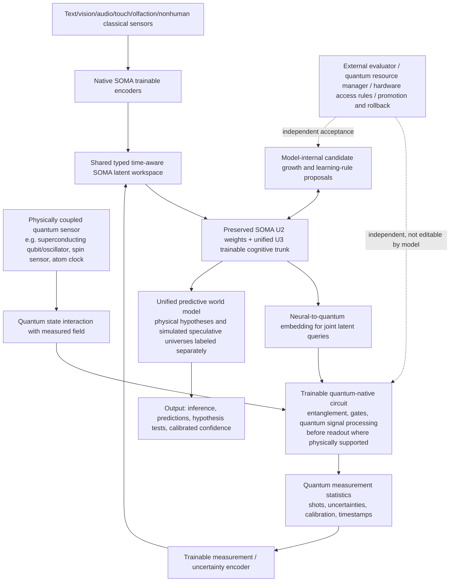

# SOMA U3 | Native Quantum Cognition, Cosmic Sensing and Speculative Physics

**Research specification v1.0 · 2026-11-20**  
**Status:** Proposed and evidence-tiered; no quantum hardware, cross-universe sensing, or native quantum network has been constructed in SOMA.  
**Parent research roadmap:** `Weaver-Soma/U3/ROADMAP_00_TO_17.md`.  
**Project constraint:** One *logical* unified SOMA cognitive model with co-trained classical and quantum-native regions. Quantum hardware and sensor devices remain physical computation/sensing resources, not separate assistant agents.

## Intent, carefully separated

The desired system is not merely a conventional model with a quantum API tool. It has a **native quantum trainable region** with parameterized qubit operations, quantum-state evolution, entangling gates and measurement-sensitive training, integrated with SOMA's sensory, predictive and self-evolving neural representations.

The user wants it to explore not only ordinary human experience but also phenomena across the universe, including speculative extra dimensions, hidden sectors and multiverse concepts.

These are **three different evidence classes**:
1. **Verified physical quantum phenomena:** magnetic/electric fields, microwave displacements, coherent spin dynamics, quantum states, precision timing and interferometry. Direct physical measurement can occur on appropriate quantum sensing hardware.
2. **Testable speculative physics:** axions/dark matter candidates, hidden photons, extra-dimension or mirror-sector predictions, variations of fundamental constants and gravitational effects. The system can analyze real instrument data and test well-defined hypotheses, but measurements to date are not confirmation of such phenomena.
3. **Hypothetical worlds and philosophical inner dimensions:** many-worlds interpretations, parallel universes, subjective inner realities, and constructed high-dimensional spaces. SOMA can learn mathematical *simulations*, probabilistic hypotheses and conceptual models. These **must not be labeled physical observations or travel/access to other universes** absent reproducible empirical evidence and a measurement mechanism. Hilbert-space dimension, mathematical latent dimension and physical spatial dimension are different concepts.

## Logical unified model architecture

The quantum region is native to the **learning architecture**, but the real QPU/quantum sensor requires external control hardware, calibration, readout and constrained compute scheduling. Physical quantum measurements return classical outputs; a unified model may optimize parameterized circuits with parameter-shift or similar estimators, but not assume end-to-end ordinary GPU autograd through unconstrained QPU hardware. **One neural model does not literally contain a free-standing universe or a fabricated physical QPU.**

## Stage Q0: Theoretical and empirical foundations
- Define observable signals, Hamiltonians/noise models, qubit and sensor requirements, predicted signal signatures and reproducible comparisons.
- Maintain an evidence registry `CONFIRMED / CANDIDATE / SPECULATIVE / NO EVIDENCE`; each hypothesis identifies measurable consequences and ways to falsify it.
- Separate mathematical Hilbert-space dimensions, AI latent dimensions, spatial extra dimensions and metaphysical descriptions.
**Gate:** every “sensing” claim is anchored to a physically available device or explicitly labeled simulation.

## Stage Q1: Trainable quantum native neural subspace, simulated initially
- Build 4–8 qubit shallow trainable quantum circuit with feature encoding, parameterized gates and measurement heads. Treat the quantum weights as part of a unified checkpoint/architecture schema.
- Simulated training on small inference tasks is for algorithm development, **not actual measurement**.
- Compare identical data/tasks against MLP, kernels, complex-valued neural models, and randomized quantum circuits under matched cost; track seed/noise sensitivity, gradients, circuit depth and simulator exponential scaling.
**Gate:** stable tensor↔quantum interface and honest benchmarks; preserve U2 outputs at zero residual initialization.

## Stage Q2: True quantum computational sensing
- Integrate **actual** quantum sensor measurements and, where feasible, coherent trainable transformations **before measurement**, not just classical postprocessing.
- Initial empirical targets are small field/displacement classification and timing/spin-sensing tasks; only sensor physics with accessible and lawful hardware.
- Train and evaluate with device/noise/calibration records, measurement shots, source ground truth, held-out runs and instrument metadata.
**Gate:** demonstration on actual hardware with objective gain or clearly characterized failure; distinguish theoretical proposals, simulations and experiments.

## Stage Q3: Fundamental physics inference across the universe
- Accept provenance-tagged measurements from physical experiments: quantum clocks, magnetometers, atom interferometers, astronomical detectors, public neutrino/cosmology archives and possible axion-search apparatus.
- Define hypothesis likelihoods and counterfactual signatures for proposed dark matter/hidden-sector/extra-dimension models; explicitly compare standard-model and instrumental-noise hypotheses.
- Report confidence intervals, upper bounds and null results without inflating them into claimed detections.
**Gate:** independent tests discriminate predictions from noise and known mechanisms. No claim of discovering unseen universes from anomalies alone.

## Stage Q4: Theoretical multiverse / inner-universe simulation
- Create separate latent hypothesis and simulator branch for mathematical cosmology, many-worlds interpretation and user-inspired experiential/philosophical models.
- Allow exploration of counterfactual laws, high-dimensional manifolds and quantum information, **clearly marked simulated or speculative**.
- If a physical hypothesis makes falsifiable predictions, hand those to the Q3 measurement track; otherwise classify it as a conceptual model.
**Gate:** provenance, ontology and calibration distinguish simulated samples from observed physical evidence.

## Stage Q5: Self-directed capability evolution
- Allow SOMA to propose bounded quantum circuit topology, entanglement layout, sensing sequence, observable design and latent fusion modifications.
- Independently benchmark gains under device noise, shots, latency, cost, and controls, including held-out apparatus configurations. External safety, data provenance, and evaluation cannot be overwritten by the model.
**Gate:** benefits generalize to previously unseen physical tasks under realistic hardware constraints.

## What evidence currently supports

- **Quantum computational displacement sensing:** an April 2026 experimental preprint reports superconducting quantum hardware classification, with up to 24 entangling gates and 38 parameters trained in simulation. Its task-specific protocol outperformed its best tested conventional measurement-plus-classifier comparator by up to **15 percentage points**. This does not establish generalized quantum AI supremacy. https://arxiv.org/abs/2604.13177
- **Quantum computational sensing methods:** 2026 work explores processing before measurement rather than merely downstream neural classification, including theoretical and simulated advantages. https://www.nature.com/articles/s41534-026-01235-w
- **Quantum sensors and particle physics:** established review covers candidate dark matter, symmetry tests, precision clocks and related measurements. https://www.nature.com/articles/s42254-024-00714-3
- **No confirmed extra dimensions in recent targeted search:** IceCube's September 2026 result reports no evidence for the tested extra-dimensional or mirror-sector features. https://icecube.wisc.edu/news/research/2026/09/searching-for-extra-dimensions-with-icecube/
- **Multiverse hypotheses have no verified detection or generally established measurement channel:** NASA describes many variants as difficult or impossible to falsify. https://science.nasa.gov/image-article/apod-2006-march-1-multiverses-do-other-universes-exist/
- **Quantum ML limits:** a 2026 peer-reviewed survey discusses current limits of quantum information encoding, noisy training and uncertain general advantage. https://link.springer.com/article/10.1007/s10462-026-11686-4

## Relationship to U3 hardware concept

The chip visualization should show an **off-die or separately fabricated quantum-sensing/QPU interface**, digital preprocessing, signal and timing links, classical neural compute tiles, high-bandwidth memory, and independent hardware resource supervision. It must not claim a general-purpose GPU die already embodies physical qubits or senses a multiverse.

## Immediate next deliverables

1. A trainable quantum-circuit module *inside* SOMA's PyTorch graph, with simulation and compatible optimizer/checkpoint tests.
2. A sensor-grounded quantum readout interface requiring device type, calibration, timestamp, shots and uncertainty.
3. Baselines and a no-advantage result path.
4. Separate scientific data and speculation registries, so SOMA can explore ambitious ideas without conflating simulations with verified discoveries.

**Design conclusion:** Native quantum computation and genuine quantum sensing are legitimate research directions for SOMA; claimed direct perception of inner dimensions or other universes is not an established quantum capability.