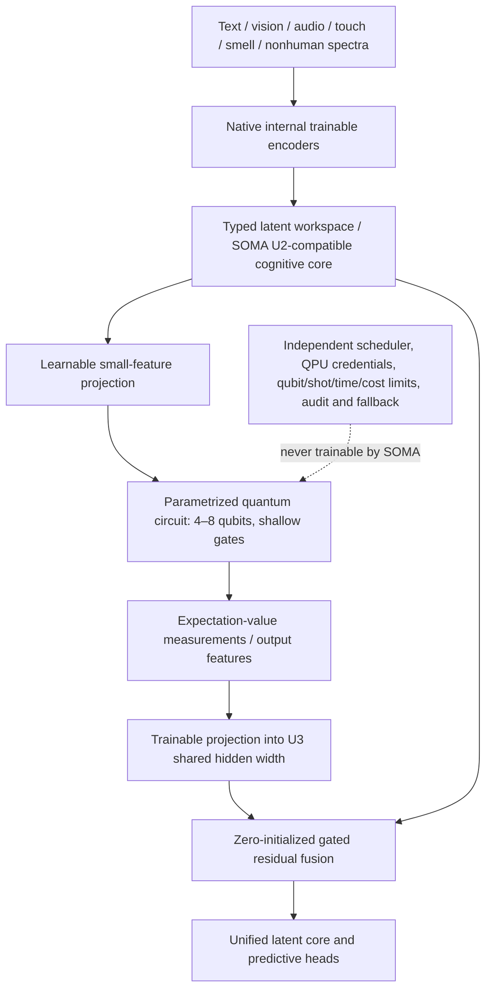

# SOMA U3 | Optional Hybrid Quantum Computing Research Stage

**Document status:** Proposed technical design; not implemented, trained, benchmarked or run on a real QPU.  
**Parent:** `Weaver-Soma/U3/ROADMAP_00_TO_17.md`, `feature/weaver-soma-u3-multimodal-evolution`  
**Suggested placement:** Stage 12Q (optional, after shared latent U3 scaffold and evaluation harness; research can start on small standalone tensors after Stages 01–03).

## Purpose and definition

Add a *trainable quantum computation pathway inside the unified model* without changing the model into a multi-agent LLM orchestration system.

A classical neural tensor can be encoded as quantum circuit rotations, processed by parametrized quantum gates (including entangling gates), and measured to recover classical features. A differential quantum node can participate in a PyTorch computation graph during simulator training; execution on a real QPU requires external physical hardware and measurement/gradient machinery. SOMA's ordinary cognitive model does not turn into a quantum computer by itself.

**Three execution targets**
1. **Quantum-inspired GPU:** low-rank, complex-valued, tensor-network or quantum-inspired methods executed classically; useful controls, **not** genuine quantum hardware.
2. **Circuit simulation:** small quantum circuit running as a PyTorch-compatible simulator (suggest 4–8 qubits initially, shallow depth; values are experimental defaults, not validated performance).
3. **Real QPU (conditional):** compatible hardware/backend runs selected circuits; gradient estimation, batching, measurement noise, circuit queuing, rate limits, provider credentials and cost remain independently controlled. This is true quantum execution, even though the surrounding model is classical.

## One-model trainable graph: gated hybrid residual

- The PyTorch-facing quantum circuit's trainable gate parameters are owned by the unified `nn.Module` checkpoint; it is **one parameter collection** and loss graph, not a second agent.
- Real QPU operation is nevertheless a separate **physical compute backend**, not extra software neurons or a quantum chip magically contained in the PyTorch module.
- For initial compatibility, `residual_gain=0` must preserve old-model outputs before quantum training begins.
- At zero gain, gradient to inner circuit parameters may be zero at initialization; train the gate first or use a controlled small nonzero warm-start after verifying legacy outputs and numerical tolerance.
- Isolate speculative quantum computation from real-time sensor perception, safety-critical inference or action execution.

## Candidate research tasks (in order)

**Q0: Bench harness and simulators.**
- Unit-test shapes, complex state, dtype, deterministic seeds, measurement ranges, gradients and checkpoint reloads.
- Validate execution time and memory; simulator state scales exponentially with qubit count. Avoid assuming efficient scaling.
- Primary implementation candidates: PennyLane QNode/TorchLayer or Qiskit Machine Learning TorchConnector with supported simulator/hardware backend.

**Q1: Quantum latent feature transforms.**
- Compress pooled U3 latents into rotation features, run shallow parameterized circuit and map expectation values to a trainable residual.
- Compare exactly against an equally trainable classical MLP or low-rank layer, plus a random quantum circuit and same-size trainable quantum circuit.
- Test on synthetic U2 sensor prediction and small crossmodal classification with matched wall time, end-to-end training compute and total cost.

**Q2: Quantum kernels/feature maps for narrow tasks.**
- Probe small tabular, sensor anomaly, chemical classification or signal recognition tasks.
- Benchmark quantum kernel classifiers against classical RBF, neural kernels and small feed-forward baselines. Include train/test leakage and hard distribution shifts.

**Q3: Quantum optimization research.**
- Explore bounded combinatorial optimization of architectural choices or sparse routing, but compare to classical heuristic/random/gradient search. Do not claim speedups from circuit simulation or a small toy problem alone.
- Quantum-inspired vs simulated quantum vs actual QPU are reported **separately**.

**Q4: Hardware experiment, only after Q1–Q3 evidence.**
- Run a very small inference/circuit benchmark on a real QPU if access and costs permit.
- Record device name, calibration date, connectivity, effective qubit count, shots, circuit depth, compile overhead, queue time, cost, observed noise, and software baseline.
- Real-device gradients might require parameter shift or related estimators with many circuit executions. QPU availability is not assumed.
- A QPU credential never enters SOMA's learned weights or untrusted experiment code.

## Evaluation and promotion requirements

- **Positive evidence:** independent held-out accuracy/prediction/retrieval or downstream learning gain; compare full wall time, energy/cost, data loading and readout latency, circuit/sample overhead and scaling. Demand statistical confidence across seeds.
- **Negative evidence:** if quantum branch underperforms a similarly parameterized classical layer, keep it disabled, with experimental logs retained.
- **Robustness:** noise, shots, hardware drift, trainability/barren plateaus and missing-QPU fallback must be measured.
- **No unsupported leap:** a model with a quantum layer is not thereby AGI, conscious, exponentially smarter, or able to access mysterious quantum perceptions.
- **Quantified scope:** quantum hardware acts as a limited computation specialist, not a drop-in replacement for training or running a 100M-parameter neural foundation model.

## Chip-architecture implication

A *conceptual* SOMA accelerator floorplan can show a **QPU interface/controller** next to ordinary GPU/tensor compute and memory fabrics. Actual qubits are not ordinary neural compute tiles. Depending on QPU technology, separate cryogenic, vacuum, optical, microwave or other hardware may be required; feasibility, packaging, control electronics and PDK/foundry work are **not designed** by this plan. Do **not** label an ordinary CMOS neural accelerator as containing verified on-chip qubits.

## Evidence and foundational references

- PennyLane Torch interface and TorchLayer: https://docs.pennylane.ai/en/stable/introduction/interfaces/torch.html and https://docs.pennylane.ai/en/stable/code/api/pennylane.qnn.TorchLayer.html
- Qiskit Machine Learning neural networks and TorchConnector: https://stfc.github.io/qiskit-machine-learning/index.html
- 2026 review discussing lack of reproducible general quantum ML advantage, encoding overhead, noise and barren plateaus: https://link.springer.com/article/10.1007/s10462-026-11744-x
- Nature's 2025 discussion of limitations of noisy quantum processors: https://www.nature.com/articles/s41534-025-01136-4

**Decision:** add Q-pathway as a *research option*, not a mandatory dependency for SOMA U3 language, multimodal perception or autonomous neural evolution. Promote only on independently benchmarked usefulness.
