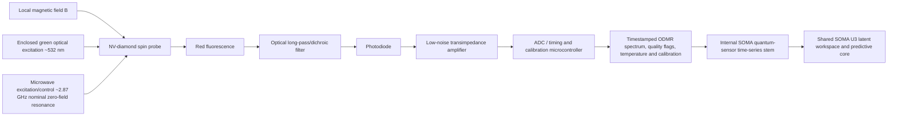
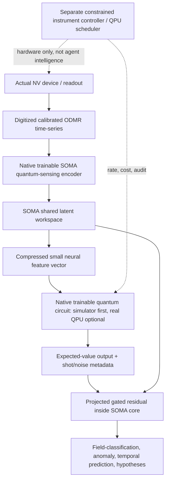

# SOMA U3: Practical Quantum Sensor and Neural-Integration Blueprint

**Date:** 2026-11-20  
**Status:** Conceptual hardware/software design based on published experiments. **No prototype has been assembled, no QPU has run SOMA, and no quantum sensor has provided live SOMA data.**

## Why include quantum capability inside the model?

Use the quantum branch as an **optional specialist**, not a general-purpose intelligence multiplier. Proposed measurable tasks:

1. **Field-pattern recognition:** detect and classify frequency/amplitude/phase patterns in quantum-sensor measurements, with confidence intervals; compare directly against MLPs, convolution, state-space models and matched classical baselines.
2. **Task-aware sensing:** choose and learn pulse sequences or quantum-control parameters to improve classification of specific sensor signals *before measurement* where compatible hardware supports coherent control.
3. **Quantum feature transformations:** project a small shared neural latent vector onto a 4–8-qubit parameterized circuit; measure expectation values; project back into 1024-dim SOMA working state with a gated residual. Verify whether the quantum branch improves downstream loss enough to justify circuit runtime and cost.
4. **Physics hypothesis testing:** forecast calibrated sensor observations and quantify discrepancies against physical noise/control models, including null results. No basis to claim multiverse detection from unstructured anomalies.

Neither the number of qubits nor entanglement implies an AGI, a new humanlike sense, or a computational speedup.

## Proposed first **physical** sensor: nitrogen-vacancy (NV) diamond magnetometer

This is a **quantum magnetometer**, not a complete quantum computer. Nitrogen-vacancy centers in diamond have electron-spin states that respond to an external magnetic field. Optical pumping and microwave resonance allow their state-dependent response to be read through fluorescence.

### Measurement chain

**Functional subsystems**:
- Diamond sample with NV centers, mounted in a stable probe head.
- Low-power **enclosed** green illumination (often ~532 nm) and collection/filter optics separating excitation light from red fluorescence.
- Tunable, appropriately shielded microwave signal generation/antenna around the diamond's ~2.87 GHz zero-field-splitting transition; frequency is swept or pulsed according to approved instrument configuration.
- Photodiode, calibrated low-noise transimpedance amplifier and ADC with stable timing.
- Optional controlled calibration field generator, temperature/reference sensor, sensor mount, shielding and logging.
- Sensor driver produces fluorescence-vs-frequency/time traces, reference baseline, temperature, timestamps, uncertainty and validity masks. It **does not invent physical field readings**.
- Laboratory safety: contained laser path with engineered interlock, compliant RF configuration, trained operator, protective electrical design and calibration. Do not aim uncontained lasers at people or operate unshielded high-power RF.

**Important experimental distinction:** A conventional optically detected magnetic resonance (ODMR) setup measures NV spin resonances by classical optical readout. It qualifies as a genuine **quantum physical sensor**, but is **not** proof of trainable coherent quantum computation before measurement. The latter requires an advanced coherent-control/pulse sequence or another research-grade sensing device.

## How to connect it to **one SOMA model**

- The **sensor stem, fusion, trainable quantum circuit parameters, and readout projection** are registered as components of a **single PyTorch model**. Physical hardware interfaces, optical control and independent security/measurement calibration cannot literally be neural weights.
- **IBM Quantum access:** useful for running quantum circuits produced by SOMA but does not remotely detect local magnetic or other fields. IBM remote QPUs cannot be used as a direct attached NV magnetometer through the ordinary cloud API.
- **Native coherent sensor research path:** a physically coupled probe has sensing interaction and trainable quantum operations before measurement on that *same device*. This is significantly harder than using IBM's QPU on already digitized data.
- Add modality timestamps, sensor identity, shot counts, QPU backend, calibration, noise and provenance. No third-party language agent is needed.

## Build stages and comparison gates

**QS0: Simulation of sensor physics.** Generate spin-resonance spectra under a known field/temperature/noise model, implement trainable ODMR-feature encoder, demonstrate field estimation and anomaly classification, evaluate against classical statistical fitting. Label all signals *simulated*.

**QS1: Hardware ODMR proof of sensing.** Assemble a lab-grade enclosed NV-diamond experiment or use accessible real measurements from validated laboratory apparatus. Confirm frequency-resonance response, calibration against a known field, repeatability, noise floor and temperature drift. Sensor and ADC operate even if SOMA is off.

**QS2: Native SOMA integration.** Ingest actual calibrated traces, define missingness/quality masks, run a PyTorch native encoder and share time-aware latent tokens. Benchmark the gain in prediction and classification versus a matched standalone classical signal-processing pipeline.

**QS3: Circuit-based trainable specialist.** Add a simulated small quantum feature layer to SOMA's shared core (4–8 qubits initially, shallow parametrized depth); compare equal-parameter MLP/kernel/recurrent features using the same data, total compute and latency.

**QS4: Real quantum-circuit experiment.** Optional IBM backend run for isolated small circuits, with live QPU scheduling/shot costs checked separately. This verifies real quantum *computation*, **not physical sensing**.

**QS5: Quantum computational sensing experiment.** On appropriate coherent-control hardware (possibly a separate institutional lab), train task-specific quantum interactions/control before readout and compare head-to-head against optimized conventional sensing followed by classical AI.

**Decision:** Do not build a speculative cryogenic quantum computer at home or alter SOMA core weights until checkpoint migration is verified. Start with simulation and a well-characterized conventional NV quantum sensing channel; let experimental results determine whether the much harder coherent quantum layer is warranted.

## Research sources checked 2026-11-20

- [Stegemann et al., 2023, edge-ML NV magnetometer](https://pmc.ncbi.nlm.nih.gov/articles/PMC9920683/): ~532 nm excitation, ~2.87 GHz microwave sweep, photodiode readout and microcontroller.
- [Low-cost ODMR experiments, 2025](https://link.springer.com/article/10.1140/epjqt/s40507-025-00326-5): optical and microwave measurement apparatus.
- [Components for an inexpensive CW-ODMR NV-based magnetometer, 2025](https://www.mdpi.com/2673-8724/5/3/18): practical optical/detector/microwave subsystems.
- [Quantum sensors that compute, 2026](https://arxiv.org/abs/2608.17400): quantum computational magnetic-field sensing with superconducting transmon qubit, task-specific comparisons.
- [Quantum computational displacement sensing, 2026](https://arxiv.org/abs/2604.13177): physically coupled qubit-oscillator system, task-specific quantum processing before measurement.

## Stage 00 checkpoint state as of this design

**Recovered U1**: ChatGPT Library artifact `weaver_soma_unified_RECOVERED.pt`, **515,038 bytes**, SHA-256 **3eb0746806f3842ec2d8121a7bcf30f5351b1b26b70e2c53debdac2ea5030c8f**, matching the U2 Stage 4 report. Hash identity verified, not yet a complete U2 reload.  
**U2 Stage 4 combined checkpoint:** expected `WEAVER_SOMA_U2_100M_Stage4_FULL_MODEL.pt`, 400,912,211 bytes, expected SHA-256 `14d170d70f7d16d2abc23721f4f4cc3a9b3d115651dffbb2e343ebfb1f135149`. **Not located in the current ChatGPT Library search, and not confirmed on the local machine.** Do not claim it has been loaded or recovered.
