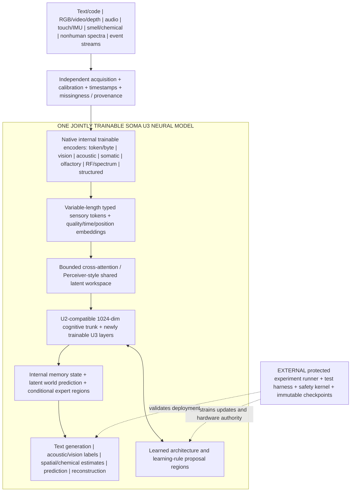

# Pursuit of AGI: Weaver-SOMA U2 to U3, Full End-to-End Plan

**Stages 00–17 | Research roadmap v1.0 | November 20, 2026**

**Project:** One original, end-to-end trainable multimodal, multisensory, self-evolving neural model. Not an LLM-agent wrapper, not a federation of independent chatbots. Specialized encoders, fusion, cognition, memory, generation and trainable evolution components are internal modules of one neural graph and checkpoint. A separate, independently enforced runtime controls what experiments may do in the physical world.

**Current status:** This document is a plan, not evidence that U3 has been trained or fabricated. The U3 branch preserves its U2 parent. The architecture document is present; this roadmap specifies what remains to be implemented.

## Baseline and immovable facts

- Existing U2 source: 100,206,197 parameters, with 10 Transformer-like attention/MLP blocks at 1024 hidden width over four internally derived tokens, plus a smaller U1 body/sensor core, expert mixing, prediction heads and 15 output entries.
- Reported U2 Stage 4 training: 240 AdamW steps on synthetic sensor/physics tasks; 100,082,241 deep-core parameters received nonzero gradient signals. Reported held-out synthetic loss improved, but no real-world sensor validation, language training, or AGI evidence.
- Historical trained U2 full-model checkpoint was reported as an external ~400.9 MB artifact, SHA-256: 14d170d70f7d16d2abc23721f4f4cc3a9b3d115651dffbb2e343ebfb1f135149. The GitHub repository does not contain this checkpoint. Verify trusted original file and strict reload before relying on retained skills. If absent, reproduce a new U2 training baseline and label it accordingly.
- U2 original forward path must remain verifiably equivalent on identical input batches before U3's new learnable paths are enabled. “One model” means trainable weights and jointly optimized internal layers; datasets, sensors, calibration, job isolation and deployment security exist outside the model for valid engineering reasons.

## Unified architecture contract

**Inputs:** text, code, byte/subword tokens, structured documents, pixels, video, depth/thermal/3D, environmental audio, speech/music, touch/force, vibration, IMU, temperature, GPS, radar/LiDAR, gas/odor/chemical arrays, optional biosignals, radio-frequency and other instrument measurements, simulation and digital event streams.

**Sensing beyond human experience:** include UV/hyperspectral, thermal, ultrasound/infrasound, radio spectra, magnetic fields, chemical spectral channels and high-dimensional telemetry where sensors and validated datasets exist. “Senses” are learned feature mappings from *measured physical signals*. The AI may also discover latent factors and predictive relationships with no direct human semantic label. This is potentially machine-native perception, but must be measured by generalization, prediction, information gain and robustness. No unsupported claims of exotic physical sensing, consciousness or omniscience.

**Encoders:** trainable native stems per signal type, such as UTF-8 byte/subword embedding; 2D patch/conv for vision; raw waveform/log-mel for audio; 1D conv/GRU/SSM for tactile and chemical time-series; point/graph encoders for geometry and relationships. Each outputs variable-length typed tokens with position, timestamp, sensor identity, validity, calibration and uncertainty metadata. Tokens project into a shared 1024-width candidate workspace, with latent bottleneck and bounded attention budget. The 1024 choice is a migration convenience, not a fixed final optimum.

**Core:** U2-compatible weights plus newly trained multimodal fusion, shared working state, selective internal expert modules, a temporal predictive world model and learned memory representations. Language autoregression, sensory classification/reconstruction, joint embedding and multi-step prediction are concurrent training objectives. Modality stems and heads remain in *one* model with end-to-end differentiable connectivity and a unified checkpoint. Sparse selection is allowed; every parameter need not activate on every input.

**Autonomous growth:** a trainable proposal mechanism can suggest bounded neuron growth, sparse rewiring, new internal regions/encoders and updates to optimizer/learning policy from the start; each candidate is trained in isolation and accepted only after independently held-out comparisons. The protected kernel and evaluator are not self-editable model components.

## Complete model diagram

## 18-stage execution sequence, with hard entry/exit gates

### Stage 00 — Asset recovery and exact U2 baseline
**Work:** Inventory U1/U2 source, named tensors, synthetic task data and all 15 outputs; recover and hash-check trusted checkpoint; strict weight load, deterministic input probes, environment lockfile. **Deliver:** baseline model card, checkpoint manifest, U2 output snapshot. **Pass when:** either original trained U2 reproduced exactly or an explicitly distinct reproducible baseline is established. **Hold if:** no trusted weights and no reproduction.

### Stage 01 — Isolated experimentation and independently enforced boundaries
**Work:** unprivileged training environment, quotas, private-data controls, immutable holdout storage and approved checkpoint promotion, explicit rollback; no production Neoh/Weaver keys or actuator authority. **Deliver:** threat model and isolated runner. **Pass when:** adversarial proposals cannot change evaluator, policy, credentials or live hardware. The model can still propose changes to its *learned* architecture.

### Stage 02 — Data, benchmarks and learning-rule experiments from day one
**Work:** version data licenses and manifests, splits by identity/scene/device/time; record compute, model size, loss, confidence and forgetting. Compare fixed optimizer, random search and self-chosen optimizer/loss schedules on matched total work. **Deliver:** experiment ledger, fixed baseline, early optimizer proposal loop. **Pass when:** a candidate improves a development metric reproducibly without accessing sealed test data and without exceeding quotas.

### Stage 03 — U3 neural graph and compatibility bridge
**Work:** implement single U3 Torch module with typed variable-length modalities, masks, position/time embeds, shared latent interface and zero-gated candidate paths. Load compatible U2 tensors unchanged. **Deliver:** U3 scaffold, state-dict migration, smoke/gradient tests for every declared input type. **Pass when:** all 15 U2 outputs are unchanged at initialization (within predeclared numerical tolerance), and every new stem can backpropagate in isolation.

### Stage 04 — Native language, bytes, tokens and code
**Work:** choose byte or learned subword tokenizer; build self-contained next-token language objective/decoder and structured text/code tasks, no external LLM inference. Evaluate text loss, perplexity, constrained reasoning and code syntax with contamination checks. **Pass when:** model learns held-out text better than trivial and compute-matched scratch baselines, with real neural output generation.

### Stage 05 — Environmental hearing
**Work:** raw waveform or log-mel audio stem; labels/detection for sirens, sneezes, coughing, animals, footsteps, motors, alarms, weather, overlapping sounds. Optional speech transcription/music later. Datasets include appropriately licensed FSD50K and other event recordings. **Pass when:** macro event metrics and localization/time precision beat baselines on genuinely unseen recordings, including noise/overlap.

### Stage 06 — Vision and video
**Work:** RGB image patches or small convolutional stem; scene/object recognition, sequential frames, visual-language pairs, optional depth/thermal sources. **Pass when:** held-out image/video metrics and synchronized audio-visual event localization improve over unimodal baselines at measured cost.

### Stage 07 — Touch, motion and body-state learning
**Work:** train tactile/pressure/force/vibration, IMU/proprioception, position, temperature and time-series encoders; synthetic-to-real domain testing, sensor-frame transforms and multi-rate clocks. **Pass when:** verified cross-sensor state prediction generalizes to changed environments and U2 old-task loss remains within thresholds.

### Stage 08 — Olfactory and chemical perception
**Work:** learn directly from calibrated electronic-nose multichannel gas/VOC time-series plus temperature, humidity, sensor identity, drift and masks. Separate real sensor measurement from text odor labels. Use device/time-separated evaluation and odor/gas classification or regression when ground truth exists. **Pass when:** reproducible held-out sensor accuracy and calibrated uncertainty across shifted devices/time; NO claim of certified fire/CO/hazard detection.

### Stage 09 — Machine-native / beyond-human physical sensing
**Work:** experimental internal encoders for machine-measurable signals: RF spectra, ultraviolet/hyperspectral, nonaudible acoustics, infrared/thermal bands, magnetic sensors, scientific measurement arrays and high-rate telemetry. Implement only where lawful data, sensor calibration and actual source are available. **Pass when:** new signal adds independently measurable predictive information after controlling for existing modalities and data leakage. Record which claims are measured versus simulated or hypothetical.

### Stage 10 — Representation discovery without predefined human labels
**Work:** build self-supervised contrastive/predictive/independence objectives, masked-sensor reconstruction, active information-gain selection and latent clustering. Let model propose new features and latent coordinates not aligned to human categories. **Pass when:** discovered factors improve held-out prediction or downstream transfer across tasks and fresh sensors beyond random/hand-designed features. Novel latent axes do not prove an unprecedented physical sense.

### Stage 11 — Joint multimodal grounding and shared world state
**Work:** train aligned crossmodal tokens, temporal fusion and learned world-state; connect vision+sound+olfaction and touch+motion and RF+spatial data when synchronized pairing exists. Robustness to missing sensors and contradictory cues is mandatory. **Pass when:** correct crossmodal retrieval, predictive tasks, temporal grounding and uncertainty outperform unimodal/late-fusion controls at matched budgets.

### Stage 12 — Unified generation and active prediction
**Work:** native autoregressive text head, future audio/event forecasting and selected sensory reconstruction heads; only then consider image/audio generation such as diffusion/flow if datasets/compute justify it. All remain trainable parts of SOMA. **Pass when:** useful generation and counterfactual prediction reproducibly improve quality and do not degrade existing tasks beyond tolerance.

### Stage 13 — Memory and continual learning without catastrophic forgetting
**Work:** train explicit short-/long-horizon recurrent or state memory, replay/distillation, elastic/adapter options, domain-shift and sequential task training. Include time-consistency probes and privacy deletion capability outside learned weights where feasible. **Pass when:** new sensory skills coexist with old ones and forgetting curves compare favorably with fixed baselines.

### Stage 14 — Autonomous structural plasticity
**Work:** add growth candidates for internal feed-forward width, block insertions (where compatible), modality stem extension, sparse pruning/regrowth, expert capacity and topology. Use function-preserving mapping where mathematically possible and migrate optimizer state. **Pass when:** self-proposed change improves compute-adjusted held-out outcomes over equal-budget random/scheduled growth and preserves U2 compatibility.

### Stage 15 — Autonomous evolution of learning methods
**Work:** model proposes/selects learning rates, update schedules, objective weighting and later learned optimizers through sandboxed meta-training. Protect sealed evaluations and prohibit code/policy edits to independent safety machinery. **Pass when:** learned changes outperform ordinary tuning across *new* tasks, not only tasks used to select them; training stability and cost are tracked.

### Stage 16 — Scaling, compression, latency and integration
**Work:** selectively scale only winning architecture operations, compare width/depth vs sparse experts vs distillation/quantization, run precision ablations and measure GPU/CPU feasibility. Test hardware availability, memory bandwidth, thermal and electricity envelope. Maintain one checkpoint schema and independent hardware deployment interface. **Pass when:** repeatable gains per GPU-hour/VRAM/latency justify scale; add no modalities solely for marketing.

### Stage 17 — Independent evaluation and bounded research release
**Work:** external/sealed test suite across text/code, environmental sound, vision, physical sensors, chemical and machine-native signals, real/synthetic generalization, unexpected inputs, safety and calibration. Red-team data poisoning, sensor spoofing, drift, reward hacking and self-modification limits. Create reproducible model card and documented limits. **Pass when:** all critical tests, rollback and deployment boundaries pass. **Outcome:** a validated research model, **not** an AGI certification; continue iteration if gates fail.

## Dependency and cost strategy

**Minimum-first:** consumer machine can prototype a few-million-parameter backbone and tiny sensory stems; do not run multiple full 100M-parameter training searches in parallel without checking VRAM, RAM, power, storage and budget. U2 CPU proof-of-training is not a full foundation pretraining result. Use GPU for expensive modality training once hardware is verified. Progressive sequence: old U2 sensor retention → trainable U3 shell → text/audio/vision in modest forms → real environmental/olfactory sensing → shared fusion → self-directed evolution. Exact run times, model quality, and GPU cost require hardware profiling; this document makes no invented performance promises.

**Data:** require provenance, labeling methodology, modality synchronization, license/commercial restrictions, consent for microphone/camera/biosignals where applicable, data leakage controls, and collected-sensor safety. Public example research: FSD50K sound events [Fon20]; Touch-and-Go tactile pairs [Yan22e]; ImageBind alignment [Gir23]; Unified-IO 2 multi-output [Lu23]; Perceiver fusion [Jae21]. Chemical sensor drift is a documented concern [Car12].

**Primary measurements:** validation/test loss and per-modality F1/mAP/accuracy, held-out perplexity, retrieval recall, calibration ECE/Brier, cross-sensor counterfactual prediction, missing-sensor degradation, representation discovery transfer, old-task retention, active parameter count, total parameter count, hardware FLOPs, GPU-hours, latency, storage, VRAM and replay stability.

**Stop/go rules:** pre-register each target; do not promote on training accuracy alone; compare against compute-matched fixed/random/scheduled controls; confirm different seeds and at least one independent task family before claiming generalized benefit; model proposals cannot approve themselves or edit their evaluators.

## Conceptual computer-chip view (NOT fabrication specifications)

The neural *model* is independent of physical implementation; initially run on standard GPU/CPU. A later hypothetical SOMA accelerator would need memory fabric for parameters/optimizer states, tensor compute, high-bandwidth I/O, streaming sensor preprocessors, scheduling for mixed expert/attention/conv/SSM kernels, and an immutable hardware/software security supervisor. Neural encoder “regions” on a conceptual die do not correspond 1:1 with physical neural layers; the same tensor units are reused for multiple modalities. No process node, TOPS, wattage, chip dimensions, or manufacturing costs are yet engineered or verified. A manufacturable chip requires a separate hardware feasibility, RTL, verification, physical design, packaging and foundry project.

## Prioritized engineering deliverables

**Repository docs:** architecture contract and this roadmap; baseline/recovery instructions; model graph + schema; dataset manifests; benchmark suite; each modality stem with unit/gradient tests; unified checkpoint migration; candidate evolution operator library; isolation harness; model card and audit artifacts.  
**Evidence chain:** every passing stage archives the exact code commit, parameter hash, data hashes, experiment configuration, evaluation results, seed and compute costs.  
**Research linkage:** supporting Undermind reviews and references, not claims that cited paper models have been trained inside SOMA.

## Research references (Undermind cite keys)

Core multimodal and world representation: [Lu23, Gir23, Jae21, Zho24, Liu23, Ma22]. Sensory data: [Fon20, Yan22e, Car12]. Growth and learned training: [Che15, Evc19, Yoo17, Met20]. Active sensing and discovered representation: [Sha23, Pin24, Amo18].

**One-line finish criterion:** SOMA U3 demonstrates one checked, jointly trainable model that learns multiple physical and digital modalities, including nonhuman instrument readings, and autonomously proposes meaningful architecture/learning modifications that survive independent evaluation. AGI and consciousness remain open questions.
